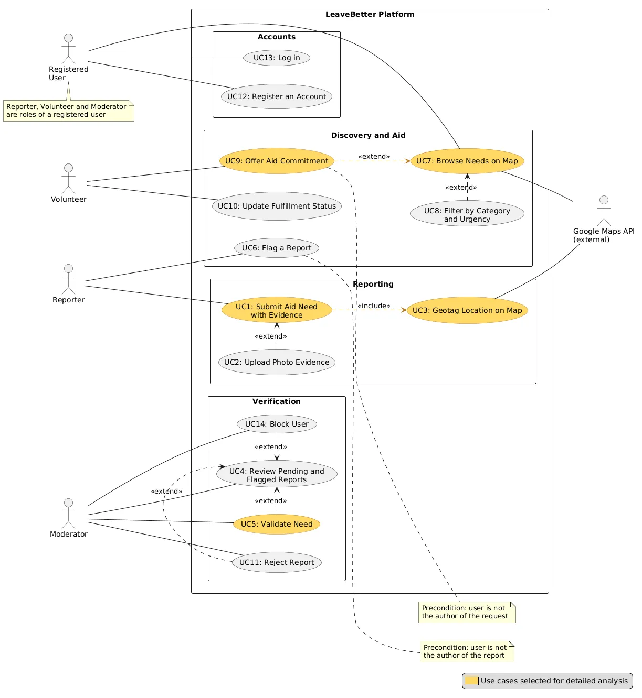

# LeaveBetter — Software Architecture Document

**Version:** 0.1 (draft)
**Status:** Design baseline, 22 November 2026. The class and database designs are agreed; application implementation has not started yet. Items marked `[TO DO]` are still missing.
**Course:** Software Engineering I

---

## 1. Introduction

### 1.1 Purpose

This document describes the architecture of **LeaveBetter**, a web app with a map that connects people who need help (food, water, education, health, construction) with volunteers: tourists who want to give something back and locals who want to help their community. It records the important architectural decisions using several views. It is written for the development team, the moderators of the project, and the course instructors.

### 1.2 Scope

The architecture covers use cases UC1 to UC14 from the Software Requirements Specification (SRS): submitting and moderating aid needs, browsing them on a map, offering help, and managing accounts. Out of scope for now: fraud-prevention details beyond what is in the SRS, and production deployment.

### 1.3 Definitions, Acronyms and Abbreviations

| Term | Meaning |
| --- | --- |
| **Aid need** | A request for help submitted by a reporter (`AidNeed`). |
| **Reporter** | A registered user who submits an aid need. |
| **Volunteer** | A registered user who offers help on a need (`AidCommitment`). |
| **Moderator** | A user whose `Profile.is_moderator` is true. |
| **MVC** | Model–View–Controller: separates data, presentation and coordination. |
| **ORM** | Object-Relational Mapper: Django turns Python classes into database tables. |
| **DRF** | Django REST Framework: builds JSON APIs on top of Django. |
| **EER** | Enhanced Entity-Relationship diagram: tables, keys and relationships. |
| **CRUD** | Create, Read, Update, Delete. |
| **UC** | Use case. |
| **SRS** | Software Requirements Specification. |

### 1.4 References

- Software Requirements Specification (SRS)
- Use case descriptions UC1, UC3, UC5, UC7, UC9 and their Gherkin feature files
- Class diagram document (Mermaid source, UC1–UC14)
- Django documentation: https://docs.djangoproject.com
- Django REST Framework documentation: https://www.django-rest-framework.org

### 1.5 Overview

Section 2 explains how the architecture is represented and how MVC maps to Django. Section 3 lists goals, technology and constraints, including CRUD. Section 4 refers to the use case view. Section 5 contains the logical view: a high-level diagram and the class diagram with the MVC parts marked. Section 7 is the deployment view and Section 9 the data view with the EER diagram. Sections 6, 8, 10 and 11 are not applicable at this stage.

---

## 2. Architectural Representation

LeaveBetter uses the **Model–View–Controller** pattern. The backend is built with Django, which uses slightly different names:

| MVC role | Where it lives in LeaveBetter | Job |
| --- | --- | --- |
| **Model** | `models.py` (Django ORM) | Holds the data and its rules. Each class of the class diagram becomes a model and a database table. |
| **Controller** | `views.py` (Django calls it a "view"; with DRF: viewsets) | Receives a request, asks the model, returns a response. |
| **View** | Serializers (`serializers.py`) plus the frontend (map and forms) | Turns data into JSON and shows it to the user. |
| **Routing** | `urls.py` | Maps a web address to the right controller. |

Example: Maria submits an aid need. The frontend sends the request, `urls.py` routes it, the controller checks it, the serializer validates the fields, the model saves one `AidNeed` row with status *Pending Review*, and a JSON answer goes back.

Views used in this document: **Use-Case View** (Section 4), **Logical View** (Section 5), **Deployment View** (Section 7) and **Data View** (Section 9). The Process and Implementation views are not needed yet.

---

## 3. Architectural Goals and Constraints

### 3.1 Technology

| Concern | Technology | Role |
| --- | --- | --- |
| Backend | Python, **Django** | Models, ORM, authentication, admin site. |
| API | **Django REST Framework** | JSON endpoints between frontend and backend. |
| Cross-origin access | `django-cors-headers` | Lets the separate frontend call the backend (all origins allowed in development only). |
| Database | **SQLite** | One file (`db.sqlite3`), enough for a university project. |
| Evidence photos | `Pillow` + `MEDIA_ROOT` | Stores uploaded evidence in the `media` folder; the database stores only the file path. |
| Map | Google Maps API (external system) | Shows needs on a map and geotags locations. |
| Tests | `behave` (Cucumber for Python) | Gherkin feature files, currently for UC1 and UC5. |
| Frontend | `React, HTML5, CSS3, JavaScript (ES6+)` | Map and forms in the browser. |

### 3.2 CRUD

Django can provide CRUD almost for free once models exist:

- The **admin site** is already enabled in `INSTALLED_APPS`. Registering a model gives create, read, update and delete pages.
- **Django REST Framework** can expose the same four operations as API endpoints with very little code.

**Current status: not used yet**, because the models have not been written. The first Create use case will be UC1 (submit aid need).

### 3.3 Constraints and design decisions

- **Registered reporters only.** Every aid need is linked to an account (`AidNeed.reporter` is required). This also supports fraud prevention, because every report can be traced to a user.
- **Moderation before publication.** A new need starts as *Pending Review* and appears on the public map only after a moderator verifies it.
- **Blocking works on two levels.** `User.is_blocked` stops a blocked account from logging in. The `BlockedUser` table stores hashes of the email and phone number, so a blocked person cannot simply register again with the same data.
- **Commitments have their own status.** Each volunteer's offer is tracked separately (*Offered*, *Completed*, *Cancelled*). If two volunteers help with one need, the database can say that one finished and the other backed out.
- **Team and schedule:** team of four, university semester schedule.

---

## 4. Use-Case View

The system covers UC1 to UC14. Actors: Reporter, Volunteer, Moderator.

| UC | Name | Main classes |
| --- | --- | --- |
| UC1 | Submit aid need | `User`, `AidNeed` |
| UC2 | Upload photo evidence | `AidNeed.evidence` |
| UC3 | Geotag location | `AidNeed.latitude`, `AidNeed.longitude` |
| UC4 | Review pending/flagged reports | `AidNeed`, `ModerationLog`, `Profile` |
| UC5 | Validate need | `AidNeed`, `ModerationLog` |
| UC6 | Flag a report | `Flag`, `AidNeed` |
| UC7 | Browse needs on map | `AidNeed` (status Verified / In Progress) |
| UC8 | Filter by category and urgency | `AidNeed.category`, `AidNeed.urgency` |
| UC9 | Offer aid commitment | `AidCommitment` |
| UC10 | Update fulfillment status | `AidNeed.status`, `AidCommitment.status` |
| UC11 | Reject report | `AidNeed`, `ModerationLog` |
| UC12 | Register an account | `User` |
| UC13 | Log in | `User` |
| UC14 | Block user | `BlockedUser`, `User`, `Profile` (moderator role) |

---

## 5. Logical View

### 5.1 Overview

The backend is a Django project with a layered flow: a request enters through `urls.py`, is handled by a controller, validated by a serializer, and uses a model that reads and writes the database. The frontend talks to the backend over HTTP with JSON, and to Google Maps directly.

### 5.2 Architecturally Significant Design Packages

The class diagram below shows the **Model** classes (the 7 classes of the design). The **Controller** and **View** parts are planned and not written yet; their names are proposals.

**How to read the relationships.** The numbers are multiplicities. Example: Maria (user #3) has reported 5 needs, so `User "1" -- "0..*" AidNeed` means one user has zero or many needs, and each need has exactly one reporter. The foreign key is always stored on the "many" side: `AidCommitment` holds `need_id`, so three volunteers on need #17 are three rows that all contain `need_id = 17`.

| Class | Responsibility |
| --- | --- |
| `User` | An account. Moderators are users whose profile has `is_moderator = true`. |
| `Profile` | Extra data per user (moderator flag, phone number). |
| `AidNeed` | One request for help, with location, category, urgency and status. |
| `ModerationLog` | One moderator decision on one need. A need can have several (for example, rejected, then resubmitted and approved). |
| `Flag` | A user's report that a need looks suspicious. |
| `AidCommitment` | One volunteer's offer to help one need, with its own status. |
| `BlockedUser` | Hashed email and phone of a blocked person, to stop re-registration. |

### 5.3 Use-Case Realizations

**UC1, Submit aid need (planned flow):**

1. The frontend sends the description, category and evidence to the backend.
2. `urls.py` routes the request to the controller for needs.
3. The serializer validates the fields.
4. The model saves an `AidNeed` with status *Pending Review* and the reporter's id.
5. The location is geotagged (UC3) and the answer goes back as JSON.

**UC5, Validate need (planned flow):**

1. A moderator opens the pending list and approves a need.
2. The controller creates a `ModerationLog` row (`decision = approved`).
3. The need's status changes to *Verified*, so it appears on the map (UC7).

---

## 6. Process View

**N/A.** The system has no architecturally significant multi-process design at this stage.

---

## 7. Deployment View

- **Player device (1..\*):** a browser that runs the frontend.
- **Server host (1):** runs the Django backend, the SQLite file and the `media` folder. In development this is the local Django development server.
- **Google Maps API:** external system used for the map and geotagging.

No public server is deployed yet. For a public deployment, HTTPS would be required.

---

## 8. Implementation View

**N/A.** Deferred until the code structure (Django apps) is agreed.

---

## 9. Data View

### 9.1 EER Diagram

...

### 9.2 Class-to-Table Mapping

| Table | Primary key | Foreign keys | Notes |
| --- | --- | --- | --- |
| `User` | `id` | none | `username` is unique. `is_blocked` stops login. |
| `Profile` | `id` | `user_id` (unique) | One profile per user. Holds the moderator flag. |
| `AidNeed` | `id` | `reporter_id` → `User` | Reporter is required (registered users only). Enums are stored as text with fixed allowed values. `evidence` stores a file path, not the image. |
| `ModerationLog` | `id` | `need_id` → `AidNeed`, `moderator_id` → `User` | Links two tables, so it has two foreign keys. |
| `Flag` | `id` | `need_id` → `AidNeed`, `reporter_id` → `User` | One row per flag raised. |
| `AidCommitment` | `id` | `need_id` → `AidNeed`, `volunteer_id` → `User` | Own `status`, so each volunteer's outcome is stored separately. |
| `BlockedUser` | `id` | `blocked_by_id` → `User` | Stores hashes only, so blocked people cannot re-register with the same email or phone. |

**Class diagram to EER.** Attributes become columns, a line between classes becomes a foreign key on the "many" side, and enums become a text column with a fixed list of allowed values. Methods are not part of the EER because tables hold data, not behavior.

---

## 10. Size and Performance

**N/A.** No sizing or benchmarks until an implementation exists.

---

## 11. Quality

**N/A** at this stage. Relevant qualities for later: security (hashed passwords, hashed blocking data, moderation before publication) and testability (Gherkin feature files with `behave`).

---

## Open Questions

- **Title and urgency in UC1:** the class diagram has `title` and `urgency`, but UC1 v0.1 only asks for description, category and evidence. Either UC1 asks for them, or a moderator sets urgency during review. `[TO DO: decide and align UC1 and the diagram]`
- **Frontend technology:** `[TO DO: confirm]`
- **One commitment per volunteer per need?** Possible unique constraint on `(need_id, volunteer_id)`. `[TO DO: decide]`
- **Django app structure:** one app or several (for example accounts, needs, moderation). `[TO DO: agree with the team]`
- **Naming convention** shared by diagrams and code. `[TO DO: agree with the team]`
- **Overlay with the diagram generated from code:** possible after the models exist. `[TO DO]`
