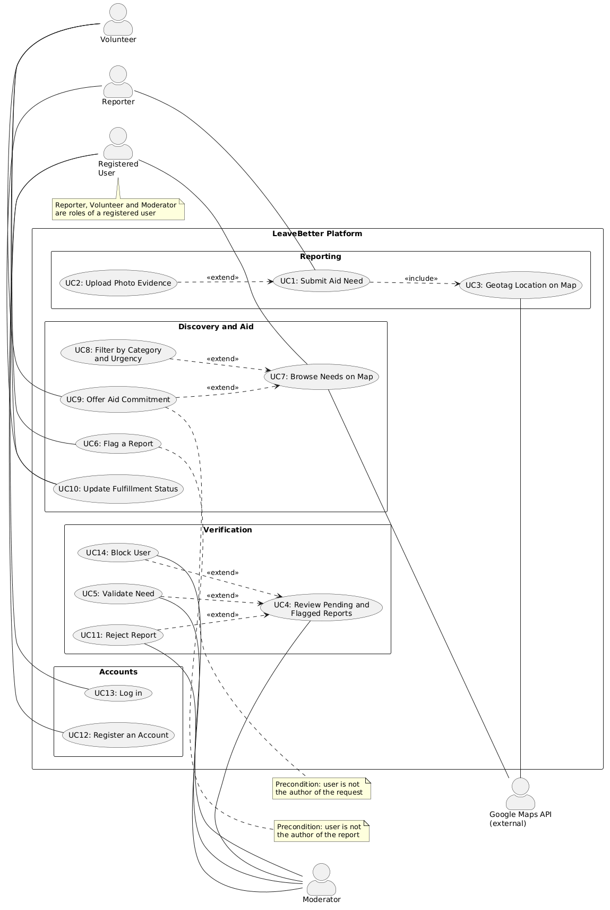

# LeaveBetter - Software Requirements Specification

## Table of contents
- [Table of contents](#table-of-contents)
- [1. Introduction](#1-introduction)
    - [1.1 Purpose](#11-purpose)
    - [1.2 Scope](#12-scope)
    - [1.3 Definitions, Acronyms and Abbreviations](#13-definitions-acronyms-and-abbreviations)
    - [1.4 References](#14-references)
    - [1.5 Overview](#15-overview)
- [2. Overall Description](#2-overall-description)
    - [2.1 Vision](#21-vision)
    - [2.2 Use Case Diagram](#22-use-case-diagram)
    - [2.3 Technology Stack](#23-technology-stack)
- [3. Specific Requirements](#3-specific-requirements)
    - [3.1 Functionality](#31-functionality)
    - [3.2 Usability](#32-usability)
    - [3.3 Reliability](#33-reliability)
    - [3.4 Performance](#34-performance)
    - [3.5 Supportability](#35-supportability)
    - [3.6 Design Constraints](#36-design-constraints)
    - [3.7 Online User Documentation and Help System Requirements](#37-online-user-documentation-and-help-system-requirements)
    - [3.8 Purchased Components](#38-purchased-components)
    - [3.9 Interfaces](#39-interfaces)
    - [3.10 Licensing Requirements](#310-licensing-requirements)
    - [3.11 Legal, Copyright and Other Notices](#311-legal-copyright-and-other-notices)
    - [3.12 Applicable Standards](#312-applicable-standards)
- [4. Supporting Information](#4-supporting-information)

---

## 1. Introduction

### 1.1 Purpose
This Software Requirements Specification (SRS) describes all software requirements for the web platform **LeaveBetter**. It outlines the vision of the project, detailed functionality, architectural choices, and the boundary conditions for development during the RUP Inception phase.

### 1.2 Scope
LeaveBetter is developed as a responsive, phone-friendly web application. The platform connects travelers and locals with communities in need, allowing users to report local aid needs and volunteers to find and fulfill them.

The system consists of the following subsystems:
- **Account system:** Every user must register and log in, so that all reports, flags and aid offers are linked to an identified person.
- **Reporting system:** Users can report local shortages (such as clean water, school supplies, or medicine) using a structured form, an optional photo and a location on the map.
- **Verification and moderation system:** Moderators review new reports and reports flagged by users. They validate or reject them, and can block users who abuse the platform.
- **Interactive map and discovery system:** An interactive map powered by Google Maps displays verified needs as pins categorized by urgency, with filters.
- **Fulfillment and matching system:** Volunteers can choose a need, pledge support or items, and update the status of the request until it is solved.

### 1.3 Definitions, Acronyms and Abbreviations

| Abbreviation | Explanation |
| :--- | :--- |
| **SRS** | Software Requirements Specification |
| **RUP** | Rational Unified Process |
| **UC** | Use Case |
| **MVC** | Model-View-Controller |
| **API** | Application Programming Interface |
| **SPA** | Single Page Application |
| **n/a** | Not applicable |
| **tbd** | To be determined |
| **GDPR** | General Data Protection Regulation (EU data protection law) |
| **Reporter** | The user who submitted a given aid request |
| **Volunteer** | Any other logged-in user who looks at or offers help on that request |
| **Under review** | Warning marker shown on a request that was flagged and is being checked by moderators |

### 1.4 References
| Title | Date | Publishing Organization |
| :--- | :---: | :--- |
| [LeaveBetter Blog](https://leavebetter5.wordpress.com/) | 15.10.2026 | LeaveBetter Team |
| [GitHub Repository](https://github.com/aylinnyma/leaveBetter.git) | 15.10.2026 | LeaveBetter Team |

### 1.5 Overview
The next section provides an overview of the project vision, technology stack, and the overall Use Case Diagram. The third chapter details specific functional requirements (using the FURPS+ model) including usability, reliability, performance, and interfaces. The final section contains team and supporting project information.

---

## 2. Overall Description

### 2.1 Vision
Inspired by mutual-aid networks and responsible travel ideas, LeaveBetter connects travelers with local communities that need support. Often, tourists want to give back to the places they visit, but they do not know what is truly needed or where to deliver help. LeaveBetter provides a community map where local needs (like books for a rural school or medical kits) are posted and verified. Volunteers can view nearby requests, commit aid, and help directly without middlemen.

### 2.2 Use Case Diagram

**Actors:** Reporter, Volunteer and Moderator are roles of a registered user. A user is the Reporter of the requests they submitted and a Volunteer on requests submitted by others. The **Google Maps API** is an external (secondary) actor used for geocoding and map display.

- **MVP / Core deliverables:**
  - UC12: Register an account
  - UC13: Log in
  - UC1: Submit aid need
  - UC2: Upload photo evidence
  - UC3: Geotag location on map
  - UC4: Review pending and flagged reports
  - UC5: Validate need
  - UC7: Browse needs on map
 
- **Extended features:**
  - UC6: Flag a report
  - UC8: Filter by category and urgency
  - UC9: Offer aid commitment
  - UC10: Update fulfillment status
  - UC11: Reject report
  - UC14: Block user

### 2.3 Technology Stack
The platform uses the following technologies:

**Backend:**
- Python 3.11+
- Django and Django REST Framework
- SQLite Database (Development phase)

**Frontend:**
- React (Single Page Application)
- HTML5, CSS3, JavaScript (ES6+)

**External Services & APIs:**
- Google Maps JavaScript API & Geocoding API

**IDE & Version Control:**
- Visual Studio Code
- Git & GitHub 

**Testing:**
- Django TestCase / Pytest for backend logic
- Jest and React Testing Library for frontend components

---

## 3. Specific Requirements

### 3.1 Functionality
This section describes the main use cases shown in the Use Case Diagram. Every use case except UC12 and UC13 requires that the user is logged in.

**Request statuses:** Pending Review, Verified, In Progress, Resolved, Rejected. In addition, a Verified or In Progress request can carry the marker **Under review** while moderators check a flag.

#### Core deliverables:

##### 3.1.1 Register an account (UC12)
Every user must register before using the platform, so that each report, flag and aid offer can be linked to an identified person. The user registers with an email address and a password; a phone number is tbd.

##### 3.1.2 Log in (UC13)
Registered users log in to use the platform. Moderators log in with moderator privileges.

##### 3.1.3 Submit aid need (UC1)
This is the core feature of the platform. A reporter submits an aid request. The user chooses a category (such as water, education, or health), sets the urgency level, enters a description, and sets the location. New requests get the status Pending Review.

##### 3.1.4 Upload verification photo (UC2)
When submitting an aid request, the reporter can optionally attach an image as proof. This helps moderators verify that the request is genuine.

##### 3.1.5 Geotag location on map (UC3)
When creating a report, the location must be specified. The system uses the Google Maps API to convert an address into coordinates and to place a pin accurately on the map. If this fails, the user picks the location manually on the map.

##### 3.1.6 Review pending and flagged reports (UC4)
To prevent scams and inaccurate information, all new reports enter a review queue. Reports flagged by users also appear in this queue. Moderators inspect the details before a report is shown publicly or while it is under review.

##### 3.1.7 Validate need (UC5)
A moderator checks the report description and photo. If valid, the moderator marks the request as Verified and it becomes visible on the public map. If the moderator checks a flagged report and finds it genuine, the flag is dismissed and the "Under review" marker disappears.

##### 3.1.8 Browse needs on map (UC7)
Every logged-in user can open the interactive map to see active needs. A user can be a Reporter and a Volunteer at the same time. Clicking a pin opens a summary card with details.

#### Extended features:

##### 3.1.9 Flag a report (UC6)
A logged-in user can flag a report that looks like a scam, a duplicate or inappropriate. The user cannot flag their own report. Each user can only flag a limited number of reports per week (limit tbd, for example 5) to prevent spam and fake flags. A flagged report stays visible, but shows the marker "Under review", so other users know it is being checked. A flag is not a decision: only a moderator can confirm a scam.

##### 3.1.10 Reject report (UC11)
If a moderator confirms that a report is fraudulent, a duplicate or violates the guidelines, the moderator rejects it with a reason. The status changes to Rejected and the report is hidden from the public map.

##### 3.1.11 Filter by urgency and category (UC8)
Users can filter map markers by category (e.g., only "Clean water") or urgency (e.g., "Critical") to find relevant requests quickly.

##### 3.1.12 Offer aid commitment (UC9)
A user can click an "Offer Aid" button on a verified request to state what supplies or time they can provide, notifying the Reporter. A user cannot offer aid on their own request. If the request is marked "Under review", the system first shows a warning message and the user must confirm before continuing.

##### 3.1.13 Update fulfillment status (UC10)
Once aid is delivered, the Reporter of the request or the Volunteer who committed can change the status from "In Progress" to "Resolved". Resolved requests are archived and no longer shown on the map.

##### 3.1.14 Block user (UC14)
If a user repeatedly abuses the platform (for example, with fake flags or scam reports), a moderator can block the account and the user's email address and phone number, so they cannot be used to register again. This makes abuse harder but cannot fully prevent it, because a person can use a new email address or phone number. Blocking whole email domains is not planned, because it would also block honest users. How blocked data is stored and for how long is tbd (see 3.11).

---

### 3.2 Usability

#### 3.2.1 Intuitive mobile-first design
The user interface is designed to work smoothly on mobile web browsers so travelers can easily use it on the go.

#### 3.2.2 Fast submission flow
Submitting an aid report takes under 3 minutes and requires no technical training or complex forms.

#### 3.2.3 Clear visual indicators
Map markers use simple, standard colors based on urgency:
- Red: Critical / Immediate
- Yellow: Medium urgency
- Green: In progress

A request that is flagged shows a small warning icon on its marker and on its detail card with the text "Under review". The icon is used instead of a new color, so it also works for color-blind users.

---

### 3.3 Reliability

#### 3.3.1 High availability
The web platform aims for 95% availability during normal development cycles.

#### 3.3.2 Data integrity
No need report can be created without valid geographical coordinates and a valid category.

---

### 3.4 Performance

#### 3.4.1 Map load speed
The interactive map should load and display up to 100 markers within 2 seconds on a regular mobile connection.

#### 3.4.2 API response time
Backend REST API endpoints should return JSON responses within 300 ms for common database queries.

---

### 3.5 Supportability

#### 3.5.1 Clean code and MVC architecture
The system strictly separates concerns:
- **Model:** Django ORM handles database models.
- **View:** React renders the user interface.
- **Controller:** Django REST APIs route requests and connect data to views.

#### 3.5.2 AI Tool usage guidelines
All team members adhere to established AI policies: prompt requests must be clear, and every piece of AI-generated code or text must be reviewed and tested by a human.

---

### 3.6 Design constraints
- **Architecture:** Decoupled frontend (React) and backend (Django) communicating via RESTful JSON APIs.
- **Repository Structure:** Documentation files must stay strictly under `/docs` and runtime code under `/src`.
- **Supported Browsers:** Chrome, Firefox, Safari, and Edge (both mobile and desktop).
- **Security and abuse prevention:** Concrete measures against fraud (for example flag limits, user blocking, and photo checks) are described in the use cases. Further security requirements will be added in a later phase.

---

### 3.7 Online user documentation and help system requirements
The interface is self-explanatory. An "About & Safety" page explains how the verification process works, along with a simple contact link for user support.

### 3.8 Purchased components
No commercial components are purchased. The system uses open-source libraries and the free development tier of Google Maps Platform.

---

### 3.9 Interfaces

#### 3.9.1 User interfaces
- **Register and login pages:** Forms to create an account and to log in.
- **Map discovery view:** The main screen showing the interactive map, pins, and filters.
- **Report submission form:** Form to enter details, upload photos, and pick a location.
- **Need detail card:** Pop-up card showing full details, the "Under review" marker, and the buttons "Offer Aid", "Flag" and "Mark as Resolved".
- **Warning dialog:** Message shown before a user offers aid on a request that is under review.
- **Moderator dashboard:** Queue interface for moderators to review pending and flagged reports, to validate or reject them, and to block users.

#### 3.9.2 Hardware Interfaces
*(n/a)*

#### 3.9.3 Software Interfaces
- Integration with **Google Maps JavaScript API** for rendering map tiles.
- Integration with **Google Geocoding API** for location conversion.

#### 3.9.4 Communication Interfaces
- HTTPS protocol for secure communication between client and server.
- JSON format for data exchange across REST endpoints.

---

### 3.10 Licensing requirements
The project is licensed under the open-source MIT License.

### 3.11 Legal, copyright and other notices
LeaveBetter processes personal data such as email addresses, phone numbers, locations and photos, so the **GDPR** applies. Contact details are kept private and are not displayed on public map endpoints.

Points to be worked out in a later phase:
- Which data is collected and why, and a privacy policy for users.
- Photos can contain location data or show people; they should be checked or cleaned before they are shown.
- Blocked users: only the data needed to prevent re-registration is stored (for example, a hash of the email and phone number), with a defined retention period and a way to appeal.
- A way for users to delete their account and data.

### 3.12 Applicable standards
Development follows clean code principles, PEP 8 standards for Python, and standard Git branch naming conventions.

---

## 4. Supporting Information
For more details, visit our blog or contact the team:
- **Project Blog:** [LeaveBetter Blog](https://leavebetter5.wordpress.com/)
- **Team Members:**
  - Dina  (UI Designer & Frontend Developer)
  - Aylin (System Analyst & Documentation)
  - Jochen (Project Manager & Requirements)
  - Mourad (Software Architect & Backend Developer)
