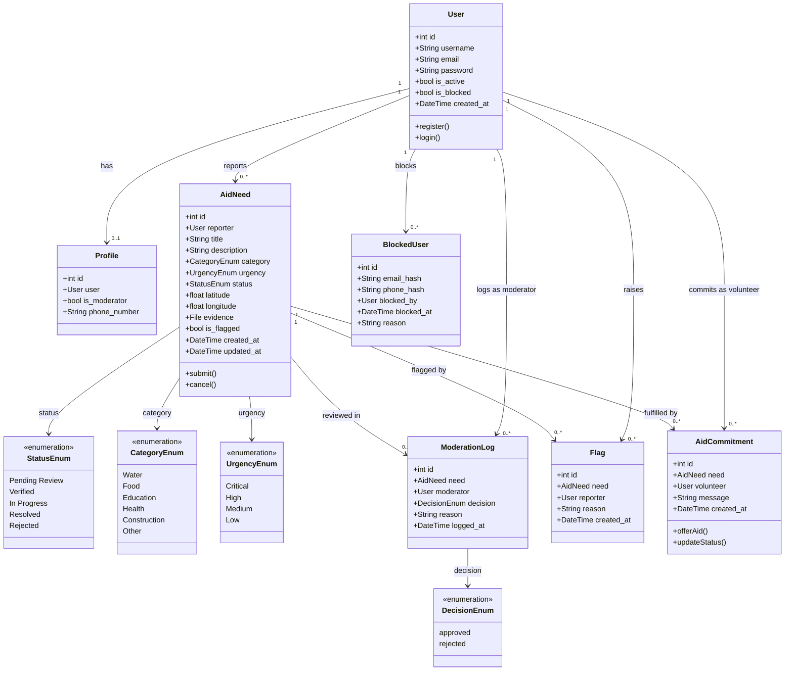

# LeaveBetter — Class Diagram

Covers all use cases from the SRS (UC1–UC14).
Will be used for the development process of the Django backend .
Rendered with [Mermaid](https://mermaid.live) — paste the block below into mermaid.live to view it.

## Actor roles

| Actor | Definition |
|-------|-----------|
| **Reporter** | A `User` who submits an `AidNeed` |
| **Volunteer** | A `User` who creates an `AidCommitment` on another user's need |
| **Moderator** | A `User` whose `Profile.is_moderator == True` |

## Use case coverage

| UC | Name | Classes involved |
|----|------|-----------------|
| UC1 | Submit aid need | `User`, `AidNeed` |
| UC2 | Upload photo evidence | `AidNeed.evidence` |
| UC3 | Geotag location | `AidNeed.latitude`, `AidNeed.longitude` |
| UC4 | Review pending/flagged reports | `AidNeed`, `ModerationLog`, `Profile` |
| UC5 | Validate need | `AidNeed`, `ModerationLog` |
| UC6 | Flag a report | `Flag`, `AidNeed` |
| UC7 | Browse needs on map | `AidNeed` (status = Verified / In Progress) |
| UC8 | Filter by category and urgency | `AidNeed.category`, `AidNeed.urgency` |
| UC9 | Offer aid commitment | `AidCommitment` |
| UC10 | Update fulfillment status | `AidNeed.status`, `AidCommitment` |
| UC11 | Reject report | `AidNeed`, `ModerationLog` |
| UC12 | Register an account | `User` |
| UC13 | Log in | `User` |
| UC14 | Block user | `BlockedUser`, `Profile` |
