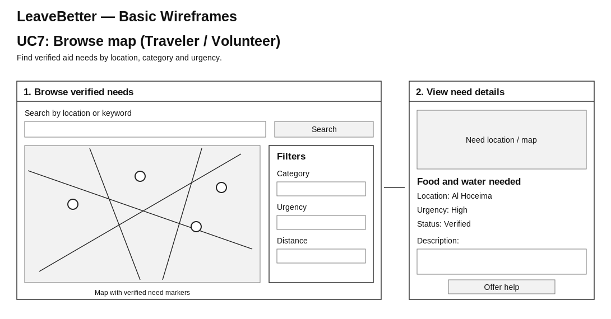
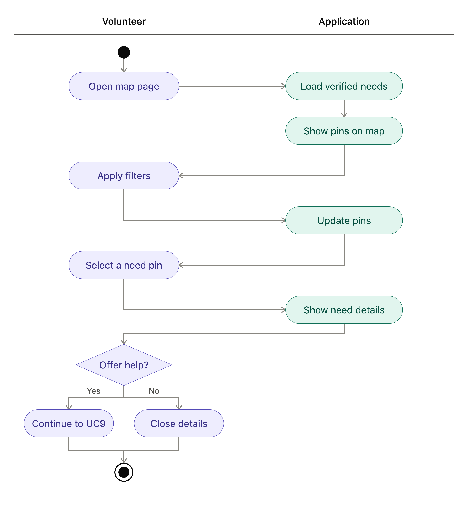

# UC7: Browse needs on map

**Type:** CRUD – **Read**
**Primary actor:** Volunteer (logged-in user)
**Supporting systems:** Google Maps JavaScript API
**Extends / Leads to:** [UC8: Filter by category and urgency](UC08-filter-by-category-and-urgency.md), [UC9: Offer aid commitment](UC09-offer-aid-commitment.md)

## 1. Use-Case Name

Browse needs on map

### 1.1 Brief Description

A logged-in Volunteer opens the interactive map view to discover verified community aid needs. The system loads active, verified needs and displays them as color-coded pins based on urgency. The Volunteer can search by location or keyword, apply filters (such as category, urgency, or distance), and select any pin to inspect its full details and optionally proceed to offer help (UC9).

Behavior as executable scenarios: [UC7 feature file]()

## 2. Flow of Events

### 2.1 Wireframe

### 2.2 Activity Diagram

### 2.3 Basic Flow

1. The Volunteer opens the interactive map page.
2. The system loads all verified and active aid needs.
3. The system displays the needs as pins on the map, color-coded by urgency level (red for critical/immediate, yellow for medium urgency, green for in progress).
4. The Volunteer optionally enters a location/keyword in the search bar or applies filters (category, urgency, distance)[cite: 5, 6].
5. The system updates the map pins to match the search and filter criteria.
6. The Volunteer selects a need pin on the map.
7. The system displays the need detail card showing the location, category, urgency, status ("Verified"), description, and any "Under review" warning marker if flagged.
8. The Volunteer reviews the details and chooses whether to offer help:
   - If the Volunteer selects "Offer help", the flow continues to [UC9: Offer aid commitment](UC09-offer-aid-commitment.md).
   - If the Volunteer closes the detail card without offering help, the system returns to the map view.
9. The use case ends.

### 2.4 Alternative Flows

**A1: No verified needs match the search or filters** (at step 5)
1. The system finds no active needs matching the selected criteria.
2. The system clears the pins from the map and informs the Volunteer that no matching needs were found.
3. The Volunteer resets or adjusts the search/filters.
4. The flow continues at step 5.

**A2: Map service unavailable or fails to load** (at step 2 or 3)
1. The Google Maps JavaScript API fails to respond or load tiles within the expected timeframe.
2. The system displays an error message informing the Volunteer that the map is temporarily unavailable and offers a retry option.
3. No map pins are rendered. The use case ends.

**A3: Volunteer flags the report** (at step 7)
1. While viewing the need detail card, the Volunteer identifies suspicious or inappropriate content and selects "Flag".
2. The flow continues to [UC6: Flag a report].

## 3. Special Requirements

- **Performance:** The interactive map must load and display up to 100 markers within 2 seconds on a regular mobile connection, and API queries should respond within 300 ms.
- **Accessibility & Visual Indicators:** Map markers use standard urgency colors (red, yellow, green), while flagged reports display a distinct warning icon alongside the text "Under review" rather than relying solely on color.
- **Visibility Rule:** Only needs with the status "Verified" (or active "In Progress") are displayed on the map; "Pending Review", "Rejected", and "Resolved" needs are excluded.
- **Mobile-First Usability:** The map and detail card must be fully responsive and usable on mobile web browsers.

## 4. Preconditions

- The Volunteer is registered and logged in.

## 5. Postconditions

- **Success:** The Volunteer has viewed verified aid needs on the map, inspected need details, and optionally initiated an aid commitment (UC9).
- **Failure:** If the map service fails, an error notification is shown and no changes are made to system state.

## 6. Extension Points

- **Offer aid commitment (UC9):** Triggered at step 8 when the Volunteer clicks "Offer help" on a need detail card.
- **Flag a report (UC6):** Triggered at step 7 when the Volunteer clicks "Flag" on a need detail card.