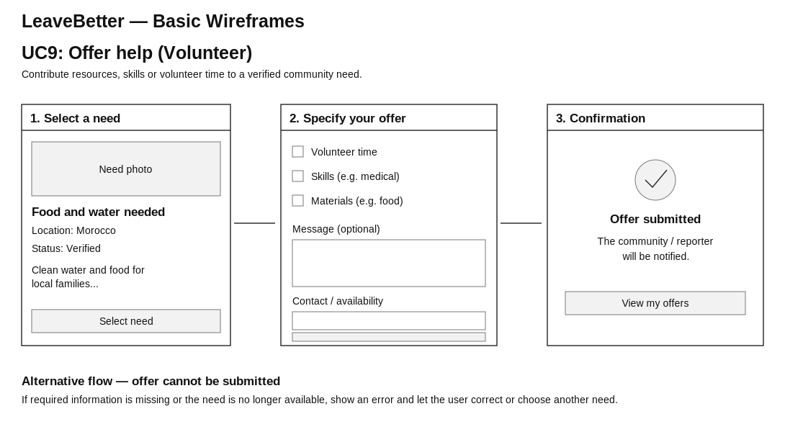
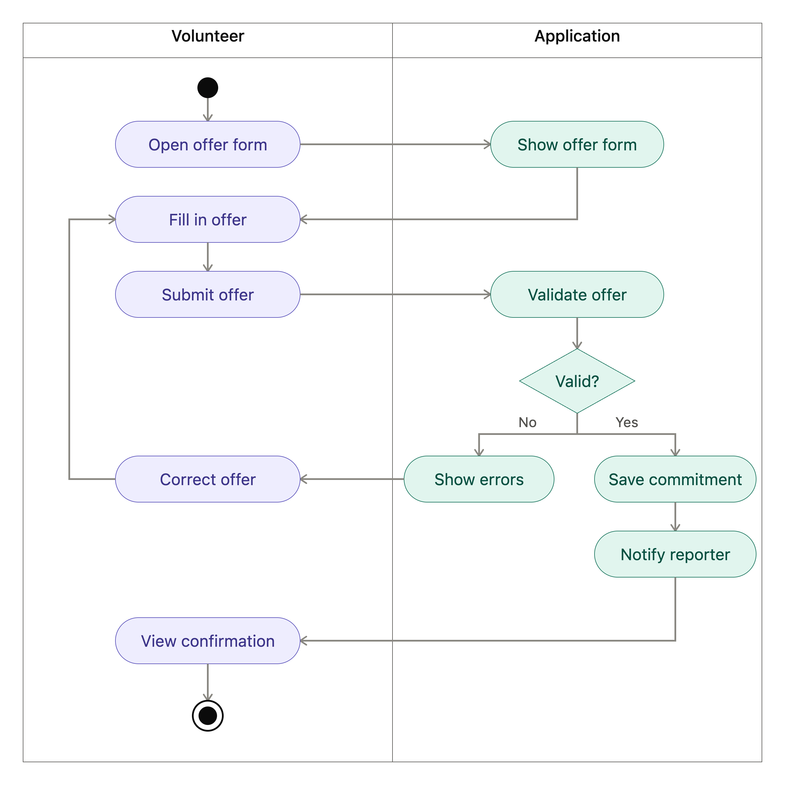

# UC9: Offer aid commitment

**Type:** CRUD – **Create**
**Primary actor:** Volunteer (logged-in user)
**Supporting systems:** none
**Extended from:** [UC7: Browse needs on map](UC07-browse-needs-on-map.md)

## 1. Use-Case Name

Offer aid commitment

### 1.1 Brief Description

A logged-in Volunteer selects a verified aid need (e.g., from the map view in UC7) and opens the offer form to pledge support. The Volunteer specifies what they can contribute (volunteer time, skills, or materials), adds an optional message and contact/availability details, and submits the offer. The system validates the input, saves the commitment, updates the need's fulfillment progress if applicable, and notifies the Reporter.

Behavior as executable scenarios: [UC9 feature file]

## 2. Flow of Events

### 2.1 Wireframe

### 2.2 Activity Diagram

### 2.3 Basic Flow

1. The Volunteer selects a verified aid need and clicks "Offer help" / "Offer Aid" to open the offer form (from step 8 of UC7).
2. The system displays the aid offer form.
3. The Volunteer selects one or more contribution types (volunteer time, skills, or materials) and enters an optional message along with their contact/availability details.
4. The Volunteer submits the offer.
5. The system validates the submitted offer data and confirms that the need is still active and available.
6. The system saves the aid commitment and updates the request status to "In Progress" if it was previously "Verified".
7. The system notifies the Reporter about the new aid offer.
8. The system displays a confirmation message to the Volunteer ("Offer submitted") with an option to view their offers.
9. The use case ends.

### 2.4 Alternative Flows

**A1: Required offer fields missing or invalid** (at step 5)
1. The system detects missing required fields (e.g., no contribution type or contact/availability selected) or invalid input.
2. The system displays validation errors next to the relevant fields.
3. The Volunteer corrects the offer details.
4. The flow continues at step 4.

**A2: Need is marked "Under review"** (at step 1)
1. If the selected need has been flagged and carries the "Under review" warning marker, the system displays a warning dialog informing the Volunteer before opening the form.
2. The Volunteer must explicitly confirm that they wish to proceed despite the warning:
   - If confirmed, the flow continues at step 2.
   - If declined, no offer is created and the use case ends.

**A3: Need is no longer available** (at step 5)
1. While the Volunteer was filling out the form, the need was already resolved, rejected, or removed.
2. The system informs the Volunteer that the need is no longer available and prevents the offer from being saved.
3. The Volunteer can return to the map to choose another need. The use case ends.

**A4: Volunteer cancels** (at any step before step 6)
1. The Volunteer cancels or closes the offer form.
2. Nothing is saved and no notification is sent. The use case ends.

## 3. Special Requirements

- **Self-Commitment Restriction:** A user cannot offer aid on a request that they submitted themselves.
- **Data Privacy (GDPR):** Personal contact details entered in the offer are shared only with the respective Reporter for coordination and are never exposed on public endpoints.
- **Warning Dialog:** Any request carrying the "Under review" marker must trigger an explicit confirmation dialog before a Volunteer can submit an offer.

## 4. Preconditions

- The Volunteer is registered and logged in.
- The Volunteer is viewing an active, verified aid need submitted by another user.

## 5. Postconditions

- **Success:** The aid commitment is saved in the database, the Reporter is notified, and the Volunteer sees the confirmation screen.
- **Failure:** No commitment is saved, and the Reporter is not notified.

## 6. Extension Points

None.