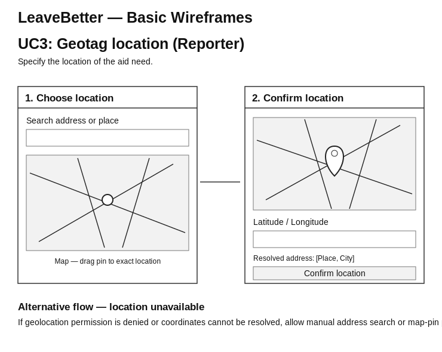
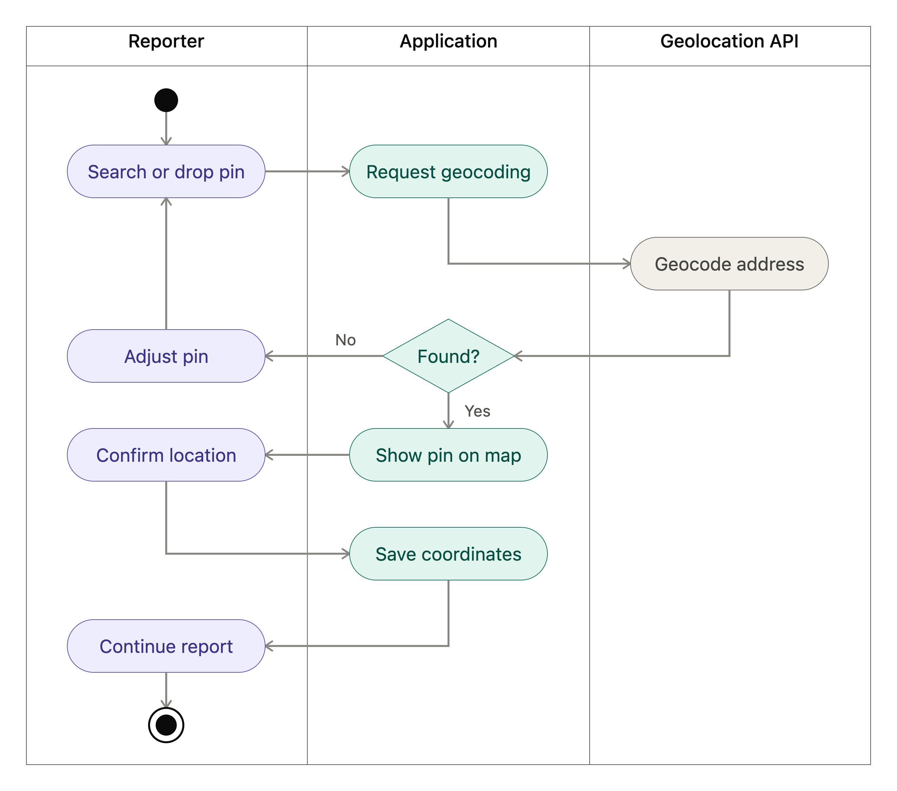

# UC3: Geotag location on map

**Type:** CRUD – **Create**
**Primary actor:** Reporter
**Supporting systems:** Google Maps JavaScript API & Geocoding API
**Included by:** [UC1: Submit aid need with evidence](UC01-submit-aid-need-with-evidence.md)

## Revision History

| Version | Date       | Description   | Author |
|---------|------------|---------------|--------|
| 0.1     | 2026-11-17 | Initial draft | Dina   |

## 1. Use-Case Name

Geotag location on map

### 1.1 Brief Description

During the creation of an aid need report (UC1), a logged-in Reporter specifies the exact geographical location of the need by searching for an address/place or dragging a pin on an interactive map. The system resolves the address into valid latitude and longitude coordinates using the Google Geocoding API, displays the resolved address and pin for confirmation, and attaches the coordinates to the report.

Behavior as executable scenarios: [UC3 feature file](../features/UC03_geotag_location.feature)

## 2. Flow of Events

### 2.1 Wireframe

### 2.2 Activity Diagram

### 2.3 Basic Flow

1. The system displays the location picker with an address search bar and an interactive map (included from step 7 of UC1).
2. The Reporter enters an address or place name in the search field or drops/drags the pin directly on the map.
3. The application sends a geocoding request to the Geolocation API.
4. The Geolocation API resolves the address/pin position into geographical coordinates (latitude and longitude) and a readable address.
5. The system displays the pin at the resolved position on the map along with the latitude/longitude and resolved address.
6. The Reporter reviews and confirms the location.
7. The system saves the validated coordinates and returns control to the aid report submission flow (UC1).
8. The use case ends.

### 2.4 Alternative Flows

**A1: Address not found or coordinates cannot be resolved** (at step 4)
1. The Geolocation API fails to find a matching location.
2. The system informs the Reporter that the address could not be resolved and prompts them to adjust the pin manually.
3. The Reporter drags the pin to the exact location on the map or enters another search query.
4. The flow continues at step 3.

**A2: Geolocation permission denied or service unavailable** (at step 1 or 3)
1. Browser geolocation access is denied or the external geocoding service is temporarily unreachable.
2. The system falls back to manual map-pin placement or manual address input.
3. If valid coordinates still cannot be determined, no location is saved and the Reporter is informed (triggering UC1 Alternative Flow A3). The use case ends.

**A3: Reporter cancels** (at any step before step 7)
1. The Reporter cancels the location selection or the parent report form.
2. No coordinates are saved. The use case ends.

## 3. Special Requirements

- **Data Integrity:** Every aid need report must have valid geographical coordinates (latitude and longitude) before it can be saved .
- **Performance:** The interactive map must load and render smoothly within 2 seconds on a standard mobile connection.
- **External Interface:** Uses Google Maps JavaScript API for map rendering and Google Geocoding API for coordinate/address resolution over HTTPS .

## 4. Preconditions

- The Reporter is registered and logged in.
- The Reporter has initiated the aid report creation process (UC1).

## 5. Postconditions

- **Success:** Valid latitude and longitude coordinates (along with the resolved address) are attached to the draft report and ready to be saved in UC1.
- **Failure:** No coordinates are saved, preventing the aid report from being submitted.

## 6. Extension Points

None.